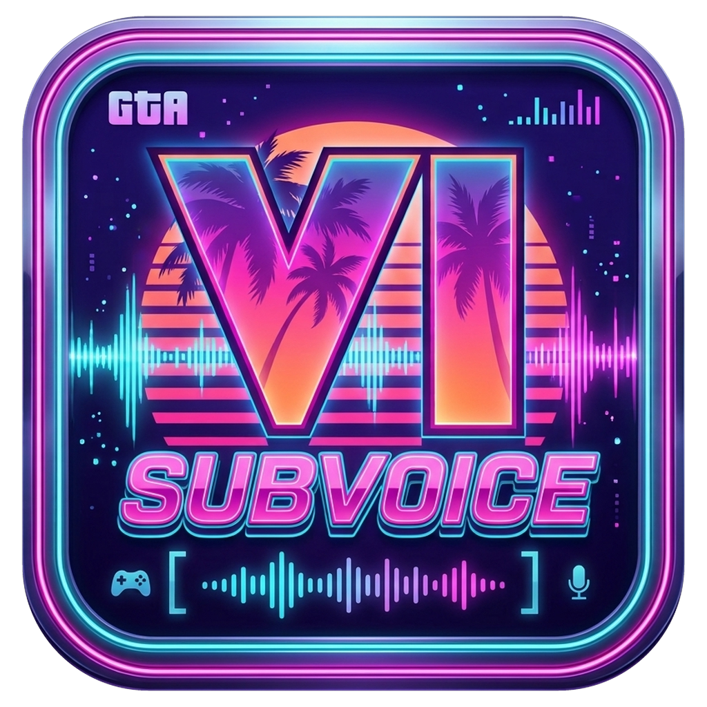
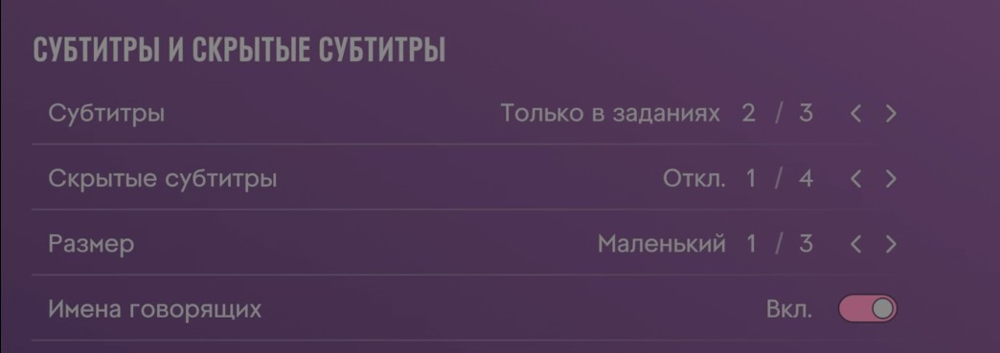

<p align="center">
  
</p>


<h1 align="center">GTA6SubVoice</h1>

<p align="center">
  Бесплатная программа с открытым исходным кодом для озвучки русских субтитров GTA VI в реальном времени.<br />
  Работает на Windows с трансляцией <b>Xbox Series X|S</b>, <b>PlayStation 5</b>, картами видеозахвата и будущей <b>ПК-версией</b>.
</p>

<p align="center">
  <a href="https://www.youtube.com/watch?v=QdBZY2fkU-0" target="_blank">
    
  </a>
  <br />
  <sub>Видео-демонстрация работы на YouTube</sub>
</p>

---

## Возможности

- **Озвучка субтитров с экрана** — считывает русские субтитры из выбранной области окна и зачитывает их по очереди без обрывов.
- **Локальный синтез речи (Silero v5.6)** — работает полностью офлайн, без API-ключей, подписок и нагрузки на видеокарту.
- **Режимы голосов** — один голос, разделение по полу персонажа (М / Ж) или до 5 разных голосов с привязкой к именам говорящих.
- **Фильтрация интерфейса** — отличает диалоги от подсказок кнопок, таймеров и надписей на карте.
- **Управление звуком игры** — может автоматически приглушать громкость выбранного окна или полностью отключать его звук на время речи диктора.
- **Горячие клавиши:**
  - `F8` — запустить / остановить озвучку
  - `F9` — выделить область субтитров на экране
  - `F10` — прервать текущую фразу и очистить очередь

---

## Настройка субтитров в GTA VI

Чтобы программа корректно распознавала текст и имена персонажей, откройте в игре:  
**Меню паузы → Настройки → Интерфейс → Субтитры и скрытые субтитры** и задайте следующие параметры:

| Параметр | Значение | Зачем это нужно |
| --- | --- | --- |
| **Субтитры** | **Вкл.** (`2 или 3 / 3`) | Включает диалоговые субтитры |
| **Скрытые субтитры** | **Откл.** (`1 / 4`) | Исключает описания фоновых звуков |
| **Размер** | **Маленький** (`1 / 3`) | Текст ровно помещается в область захвата |
| **Имена говорящих** | **Вкл.** | Нужны для подбора мужского или женского голоса |
| **Фон** | **Сплошной** (`3 / 3`) | Помогает надёжно отделять субтитры от фона игры |

<p align="left">
  
</p>


---

## Как пользоваться

Программа захватывает изображение из любого окна Windows — локальной игры, трансляции с консоли или окна предпросмотра карты захвата:

- **Xbox Series X|S:** через официальное приложение **Xbox** (`XboxPcApp.exe` → «Удалённая игра на этом устройстве») или через браузер (**Xbox Cloud Gaming** / **Better xCloud**).
- **PlayStation 5:** через **PS Remote Play** (`RemotePlay.exe`) или **Chiaki-ng**.
- **Карта видеозахвата:** через окно предпросмотра в **OBS Studio** (подходит для игры на ТВ без задержки управления).
- **ПК-версия GTA VI (после выхода):** напрямую в режиме **«Окно без рамки» (Borderless)**.

### Быстрый старт

1. Запустите **GTA6SubVoice**. При первом старте облегчённой версии программа предложит скачать модели распознавания текста и синтеза речи.
2. На главном экране в блоке **«Процесс игры / окна»** выберите приложение с игрой или трансляцией (вручную из списка или кнопкой **«Выбрать...»**).
3. Нажмите **`F9`** и выделите мышкой нижнюю область экрана, где выводятся субтитры, затем нажмите `Enter` или сделайте двойной клик.
4. Нажмите **`F8`** для запуска озвучки.

> **Важно:** выбор процесса обязателен — к нему привязаны область захвата, пауза при сворачивании окна и приглушение/отключение звука игры.

---

## Системные требования

- **ОС:** Windows 10 (64-bit) / Windows 11 (64-bit) *(используются Windows-механизмы захвата экрана, WASAPI-аудиомикшер и системные хоткеи)*
- **Процессор:** любой 4-поточный CPU с поддержкой AVX2
- **ОЗУ:** от 8 ГБ *(программа занимает ~850–900 МБ)*
- **Видеокарта:** любая *(GPU не используется)*
- **Диск:** ~1.2 ГБ свободного места

---

## Запуск и сборка из исходников

Требуется **Python 3.12 (64-bit)**.

```powershell
git clone https://github.com/dev-drozd/GTA6SubVoice.git
cd GTA6SubVoice
py -3.12 -m venv .venv
.\.venv\Scripts\activate
python -m pip install --upgrade pip
pip install -r requirements.txt
```

Запуск из исходников и сборка портативного `.exe`:

```powershell
# Запуск из исходников
python main.py

# Сборка облегчённой версии (модели скачаются при первом запуске)
build.bat --lite

# Сборка полной версии (если модели уже загружены в папку models/)
build.bat --full
```

Готовые сборки создаются в `dist\GTA6SubVoice_lite\GTA6SubVoice.exe` или `dist\GTA6SubVoice\GTA6SubVoice.exe`.

---

## Лицензия

Проект распространяется под лицензией [`LICENSE`](LICENSE) — код можно свободно использовать и изменять с обязательным сохранением указания автора (**Oleksandr Drozd / dev-drozd**) и кнопки/диалога поддержки проекта в интерфейсе и производных сборках.

---

## Поддержать проект

Программа полностью бесплатна. Если она оказалась полезной, поддержать разработку можно здесь:

- **GitHub Sponsors:** [github.com/sponsors/dev-drozd](https://github.com/sponsors/dev-drozd)
- **Revolut:** [revolut.me/devdrozd](https://revolut.me/devdrozd)
- **Binance Pay ID:** `483490297`

Если проект оказался полезным — поставьте звёздочку ⭐ на **GitHub**, это лучшая поддержка для развития программы!
